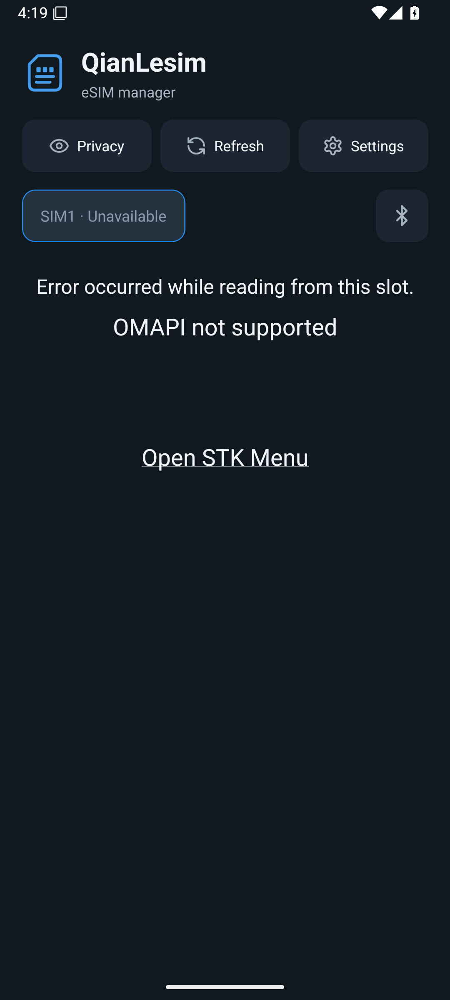
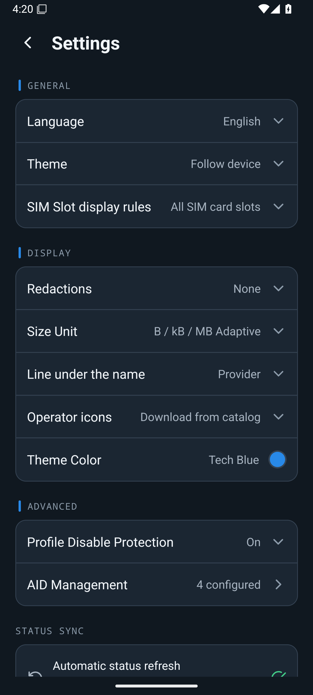
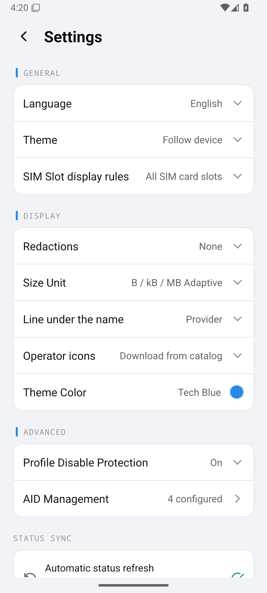
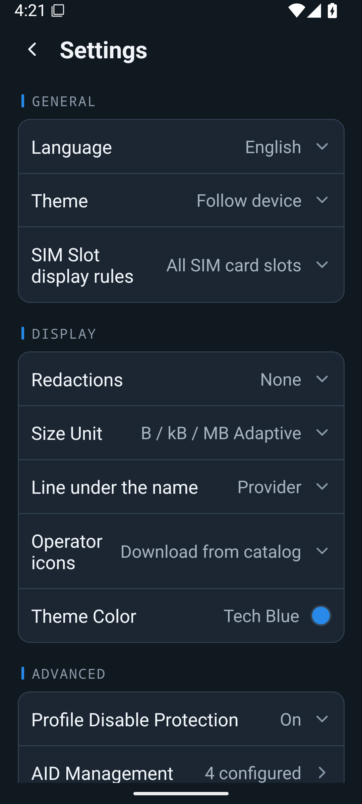

# 1.1.0 Android 页面检查

来源：[成功构建 42056466890](https://github.com/meetjor/NekokoLPA/actions/runs/42056466890)，源码 `c7d7f5989b06578711380bdd75134169282db81b`。截图来自 API 35 x86_64 模拟器运行实际 Release 应用，英文系统、1080 × 2400、420 dpi，默认字体及 1.3 倍字体。

自动检查已确认应用启动、进入设置以及深浅色页面能够显示。人工查看以下截图，未见所显示文字相互覆盖；放大字体时长设置名换行。这不是完整视觉或功能验收。

模拟器没有真实 eUICC，因此首页出现 **OMAPI not supported** 是该测试环境的预期结果，不能据此判断用户手机的读卡权限。此处没有伪造配置数据。真实配置卡片、中文布局、桌面图标、覆盖安装和切换行为需要真机补充验证。

| 深色首页（无 eUICC） | 深色设置 |
| --- | --- |
|  |  |

| 浅色设置 | 1.3 倍字体 |
| --- | --- |
|  |  |

请覆盖安装 [1.1.0 ARM64 APK](https://github.com/meetjor/NekokoLPA/releases/download/v1.1.0-qianlesim-3sign/QianLesim-v1.1.0-arm64.apk)，先确认读取现有配置，再双向切换，观察 Loading 结束和无需下拉刷新显示正确状态。检查添加配置入口、设备详情、设置、长名称与字体放大的布局即可，无须为测试删除 eSIM。
