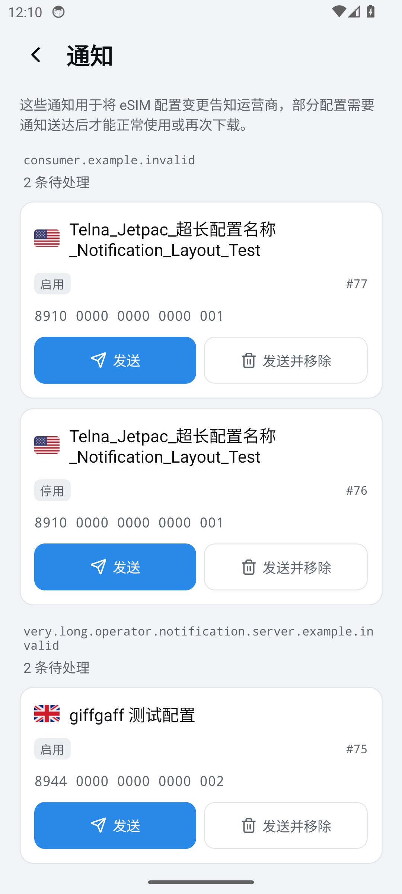
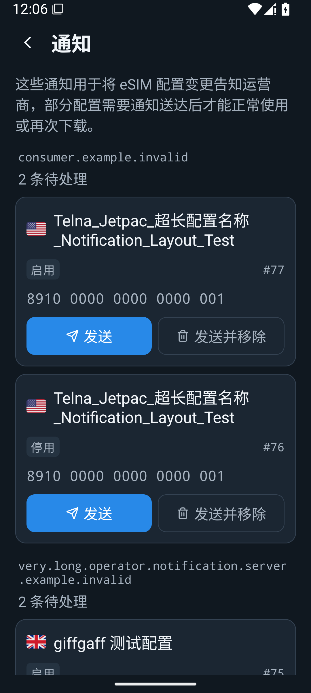
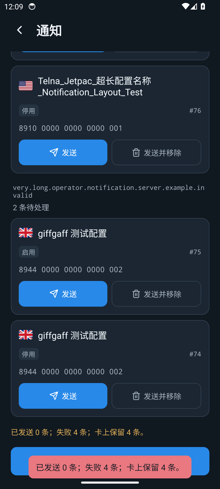

# QianLesim 1.1.3 · Android 页面验证

核验日期：2026-11-07（北京时间）。构建 [42213389165](https://github.com/meetjor/NekokoLPA/actions/runs/42213389165)，源码 `3dcb622ab1d032efcd9be8a6231d93116c479711`。

以下是 Android 模拟器实际截图，使用合成配置名称、卡标识及 `.invalid` 地址；不是用户的真实卡数据，也不是设计效果图。正式 ARM64 包在测试入口注入前已签名上传，以下使用非发布 x86_64 检查包。

| 检查项 | Android 14 / API 34 | Android 15 / API 35 |
| --- | --- | --- |
| 深色与浅色通知页、首页、设置 | 通过 | 通过 |
| 1.3 倍字体与长名称/服务器 | 通过 | 通过 |
| 标题、ICCID、操作按钮原生边界无重叠 | 通过 | 通过 |
| 单条失败后保留，发送并移除不绕过失败 | 通过 | 通过 |
| 全部失败显示 0 发送 / 4 失败 / 4 保留 | 通过 | 通过 |
| 状态栏与页面背景一致，图标可见 | 截图核验通过 | 截图核验通过 |

状态栏空白区与页面空白区像素一致：浅色 `(242,243,246)`、深色 `(16,24,32)`。长列表正常滚动，截图仅展示可见区域。批量失败图底部红色浮层是短暂错误提示，页面上方同时保留黄色统计结果，不是原先的红绿滑动底层。

## Android 14 · 浅色

## Android 15 · 1.3 倍字体

## Android 14 · 全部发送失败

## 验证边界

自动化断言来自 `scripts/capture-android-ui.py`，截图人工核对补充视觉检查。完整截图/XML/logcat 位于该构建的 `QianLesim-Android-UI` artifact（14 天保留）；此处三张 PNG 保存在仓库，供后续接管长期查阅。

尚不能据此确认真实 OMAPI、USB/BLE、运营商下载兼容和覆盖安装成功。手机只需按正常使用检查覆盖安装、读卡、双向切换、通知/状态栏及隐私遮罩；不为测试删除 eSIM。
